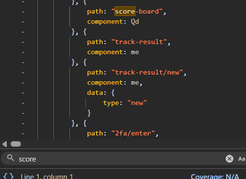

# Score Board

- **Difficulty:** ⭐
- **Category:** Miscellaneous
- **Date solved:** 2026-11-25

## The goal

Find the hidden **Score Board** page. It lists every challenge in Juice Shop
and tracks which ones are solved, but there's no link to it anywhere in the
shop's menus.

## Background: why look in the JavaScript?

Juice Shop's frontend is a **single-page application (SPA)** built with Angular.
In an SPA, the browser downloads the app's JavaScript once, and that JavaScript
decides which page to show for each URL. This is called **client-side
routing**.

That means the list of every page the app knows about (its **routes**) has to
be inside the JavaScript sent to my browser, including pages that aren't linked
anywhere in the menus. So if a page is hidden, reading the JavaScript should
reveal it.

## What I did

### Step 1: Open DevTools → Sources

With Juice Shop open at `http://localhost:3001`, I pressed `F12` to open the
browser DevTools and went to the **Sources** tab. This tab shows every file the
page loaded, including JavaScript.

### Step 2: Open `main.js`

In the file tree I found and opened `main.js`, which holds the application's
own code.

The file is **minified**: whitespace and line breaks are removed so it downloads
faster, which makes it almost impossible to read as-is.

### Step 3: Pretty print with `{}`

I clicked the **`{}` (Pretty Print)** button at the bottom of the code panel.
It reformats the minified code with indentation and line breaks so it can be
read like normal code.

### Step 4: Search the source code

I searched through the pretty-printed code (`Ctrl + F` searches the open file).

- Search term I used: `score`

### Step 5: Find the relevant code under `routes`

The search led me to the part of the code that defines the app's **routes**,
the list that maps URL paths to pages. In that list I found the entry for the
Score Board.

- Route path I found: `score-board`



## The solution

I went to the route I found by typing it into the address bar:

```
http://localhost:3001/#/score-board
```

The Score Board opened and Juice Shop showed the "challenge solved"
notification.

## Why it works

This is an example of **security through obscurity**: the page is "protected"
only by not linking to it. But with client-side routing, every route has to be
shipped to the browser, so anyone can find hidden pages by reading the
JavaScript. A missing link hides a page from casual users, not from someone
who opens DevTools.

## What I learned

- How to use the DevTools **Sources** tab to read a site's JavaScript.
- Minified code can be made readable with the **`{}` Pretty Print** button.
- SPAs define their routes in client-side code, so looking at the routes shows
  every page the app has, even ones that aren't linked.
- Hiding something is not the same as securing it.
- `[TODO: anything else you noticed or learned]`

## Remediation

**Vulnerability:** sensitive page hidden only by not linking to it (security
through obscurity). Related to OWASP Top 10 **A01: Broken Access Control**.

How a developer should fix it:

1. **Don't treat hidden URLs as protection.** Assume every route, file and
   endpoint shipped to the browser will be found. Client-side code is public.
2. **Enforce access control on the server.** If a page shows restricted
   information, the backend API that returns that data must check that the user
   is logged in and allowed to see it (authentication + authorization). Hiding
   the frontend route alone does nothing.
3. **Add route guards on the frontend as well (Angular `canActivate`)** for a
   better user experience. This is only a convenience, never the real security
   control, because it runs in the browser and can be bypassed.
4. **Ship only what's needed.** Leave admin or debug pages out of the public
   production bundle, or put them in a separate app that only authorized users
   can load.

> Note: in Juice Shop the Score Board is hidden on purpose, since finding it is
> the first challenge. The fixes above apply to real applications.
