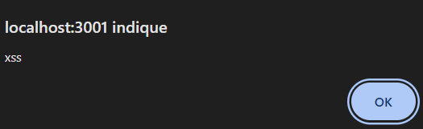

# DOM XSS

- **Difficulty:** ⭐
- **Category:** XSS
- **Date solved:** 2026-11-25

## The goal

Perform a **DOM-based XSS** attack using this payload:

```html
<iframe src="javascript:alert('XSS')">
```

## Background: what is DOM XSS?

**Cross-Site Scripting (XSS)** happens when an attacker gets their own
JavaScript to run in someone else's browser, on a trusted site.

In **DOM XSS**, the whole attack happens inside the browser: the page's own
JavaScript takes user input (from a search box or the URL, for example) and
writes it into the page (the **DOM**) as HTML. If that input contains HTML
tags, the browser treats them as real HTML instead of plain text.

The payload uses an `<iframe>` whose `src` is a `javascript:` URL. When the
browser loads the iframe, it runs the JavaScript in it, here `alert('XSS')`,
which pops up a dialog to prove the code ran.

## What I did

### Step 1: Inject the payload

I typed the payload into the shop's **search bar**:

```html
<iframe src="javascript:alert('XSS')">
```

### Step 2: URL-encoded version

I also encoded the payload with [urlencoder.org](https://www.urlencoder.org/).
URL encoding replaces special characters (like `<`, `"` and spaces) with `%`
followed by their hex code, so the payload can be safely put in a URL:

```
%3Ciframe%20src%3D%22javascript%3Aalert%28%27XSS%27%29%22%3E
```

### Step 3: Result

The browser showed an alert dialog from `localhost:3001`, which proves my
JavaScript ran on the page, and the challenge was solved.



## Why it works

The page takes my input and inserts it into the DOM as **HTML** instead of
**text**. So instead of displaying the characters `<iframe ...>`, the browser
builds a real iframe and runs the `javascript:` URL inside it.

Because this input can also go in the URL, an attacker could send a victim a
link with the encoded payload. When the victim opens it, the script runs in
their browser, on the real site, with access to their session.

## What I learned

- What DOM XSS is and how it differs from server-side XSS: the browser's own
  JavaScript puts the input into the page.
- An `<iframe>` with a `javascript:` URL can run code without a `<script>` tag.
- How URL encoding works, and that payloads can be delivered through a link.

## Remediation

**Vulnerability:** user input written into the page as HTML (DOM-based XSS).
Related to OWASP Top 10 **A03: Injection**.

How a developer should fix it:

1. **Treat user input as text, never as HTML.** Use safe APIs such as
   `textContent` instead of `innerHTML`. In Angular, use normal interpolation
   (`{{ value }}`), which escapes HTML automatically.
2. **Don't bypass the framework's protection.** Angular sanitizes HTML by
   default. Functions like `bypassSecurityTrustHtml()` switch that off and
   should never be used on user input.
3. **Validate and encode input** wherever it's reflected, including values
   read from the URL.
4. **Add a Content Security Policy (CSP)** that blocks inline scripts and
   `javascript:` URLs, as an extra layer of defense if something slips
   through.
