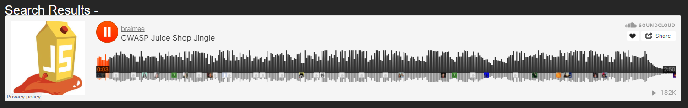

# Bonus Payload

- **Difficulty:** ⭐
- **Category:** XSS
- **Date solved:** 2026-11-25

## The goal

Use the bonus payload given by the challenge in the same DOM XSS vulnerability:

```html
<iframe width="100%" height="166" scrolling="no" frameborder="no" allow="autoplay" src="https://w.soundcloud.com/player/?url=https%3A//api.soundcloud.com/tracks/771984076&color=%23ff5500&auto_play=true&hide_related=false&show_comments=true&show_user=true&show_reposts=false&show_teaser=true"></iframe>
```

## Background

This challenge reuses the DOM XSS from the [previous writeup](02-dom-xss.md):
the search results page inserts the search term into the page as **HTML**
instead of plain text.

This time the payload doesn't run JavaScript. It's an `<iframe>` that embeds a
**SoundCloud player** from another website (`w.soundcloud.com`). Some of the
attributes in it:

- `src`: the address of the page loaded inside the iframe, here the SoundCloud
  player for one specific track.
- `auto_play=true` (inside the `src` URL): starts playing the track
  automatically.
- `width` / `height`: the size of the embedded player.

## What I did

### Step 1: Inject the payload

I pasted the bonus payload into the shop's **search bar**, the same place I
used for the DOM XSS challenge.

### Step 2: Result

The search results page didn't show my search text. Instead it rendered the
real SoundCloud player and started playing the **OWASP Juice Shop Jingle**,
and the challenge was solved.



## Why it works

The page writes my search input straight into the DOM as HTML, so any HTML
tag I type gets built by the browser. That includes an `<iframe>` that loads
content from a completely different website.

This shows that XSS-style injection isn't only about `alert()` popups. An
attacker could use the same flaw to:

- embed content from their own site inside a trusted page
- show a fake login form inside an iframe to steal credentials (phishing)
- autoplay media, or load ads or malicious pages, in front of the victim

## What I learned

- HTML injection can load full external content, not just run scripts.
- An `<iframe>` can embed any website inside the vulnerable page.
- The same vulnerability can be abused with many different payloads, so
  blocking one specific payload (like `alert`) isn't a real fix.

## Remediation

**Vulnerability:** user input written into the page as HTML (DOM-based XSS /
HTML injection). Related to OWASP Top 10 **A03: Injection**.

How a developer should fix it:

1. **Display user input as text, not HTML.** Use `textContent` or Angular's
   normal interpolation (`{{ value }}`), which escapes tags so `<iframe>` shows
   up as text instead of being built.
2. **Never use `bypassSecurityTrustHtml()` on user input.** It turns off
   Angular's built-in sanitizer.
3. **Don't rely on blocklists** (for example, blocking the word `alert` or
   `script`). There are many ways to write a malicious payload. Fix the root
   cause, which is treating input as HTML.
4. **Add a Content Security Policy (CSP)** with a `frame-src` rule that only
   allows trusted sites to be embedded in iframes, so unknown external content
   can't load even if injection happens.
