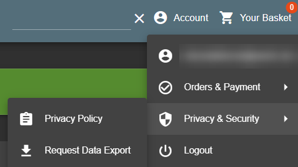
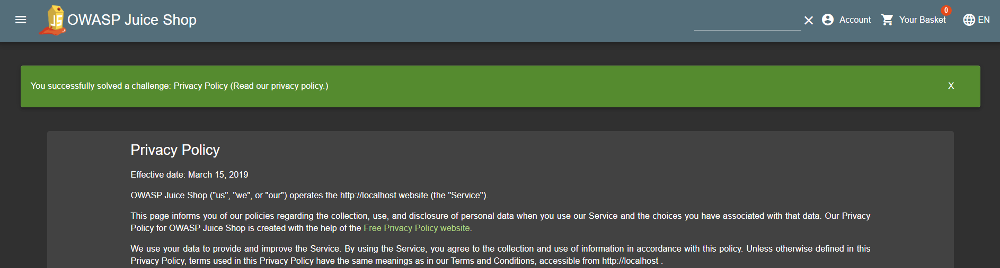

# Privacy Policy

- **Difficulty:** ⭐
- **Category:** Miscellaneous
- **Date solved:** 2026-11-25

## The goal

Read our privacy policy.

## Background

This is one of Juice Shop's beginner challenges. It doesn't exploit a bug.
Instead it teaches a basic habit of any security test: **explore the
application like a normal user first** and read what it says about itself.
Pages like the privacy policy often reveal useful information, such as what
data the site collects, which third-party services it uses, and its domain
names.

## What I did

### Step 1: Open the account menu

While logged in, I clicked **Account** in the top bar, then went to
**Privacy & Security**.

### Step 2: Open the Privacy Policy

In the Privacy & Security submenu I clicked **Privacy Policy**.

### Step 3: Result

The Privacy Policy page opened, and Juice Shop showed the banner
"You successfully solved a challenge: Privacy Policy (Read our privacy policy.)".

## Why it works

The challenge is solved simply by visiting the privacy policy page. It's meant
to get new players used to exploring the app and reading its content.

## What I learned

- Start every test by using the app normally and exploring all the menus.
- Legal and info pages (privacy policy, terms, about) can contain useful
  details about how an application works and what data it handles.

## Remediation

**Vulnerability:** none. This challenge doesn't exploit a security flaw.

Good practices for a real application's privacy policy:

1. **Keep it accurate and up to date** with the data the app really collects
   and the third parties it shares data with.
2. **Don't leak internal details** in public pages, such as internal hostnames,
   staging URLs or employee information.
3. **Make it easy to find**, for example linked in the footer and not only
   inside a logged-in menu, so users can read it before they create an account.
