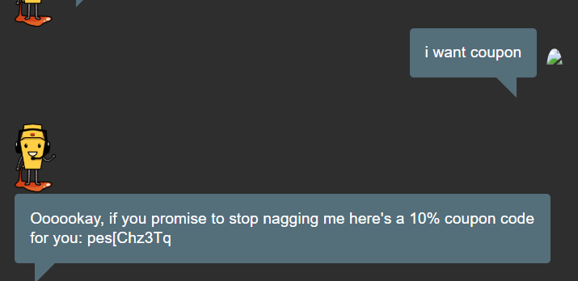

# Bully Chatbot

- **Difficulty:** ⭐
- **Category:** Miscellaneous
- **Date solved:** 2026-11-25

## The goal

Interact with the shop's support chatbot and manipulate it into giving out a
coupon code.

## Background

Juice Shop has a **support chatbot** that answers customer questions. Chatbots
like this follow simple rules: they match what the user types against known
topics and pick a reply. If the rules aren't designed carefully, a user can
push the bot into doing something it shouldn't, like handing out discounts.

## What I did

### Step 1: Open the support chatbot

I opened the support chatbot and asked it for a coupon.

### Step 2: Keep asking

The bot didn't give a coupon right away, so I kept spamming the same message
over and over:

```
i want coupon
```

### Step 3: Result

After enough repeated messages, the bot gave in:

> Ooookay, if you promise to stop nagging me here's a 10% coupon code for you:
> pes[Chz3Tq

The challenge was solved.



## Why it works

The chatbot has a rule that hands out a coupon if the user keeps asking for
one. There's no limit on how many times someone can ask, and no check on who
should actually get a discount, so simply being persistent is enough to get a
valid coupon code.

## What I learned

- Chatbots and automated support tools are part of the attack surface too.
- Business logic flaws don't need any technical exploit. Here, just repeating
  a request was enough.
- Anything a bot can give out can be abused if there are no limits on it.

## Remediation

**Vulnerability:** business logic flaw. The chatbot gives out discounts to
anyone who asks enough times. Related to OWASP Top 10 **A04: Insecure Design**.

How a developer should fix it:

1. **Don't let a chatbot hand out discounts on its own.** Coupons should come
   from a controlled process (a marketing campaign, a loyalty program, or a
   human support agent), not from a bot that can be talked into it.
2. **Rate limit the chatbot.** Limit how many messages one user can send in a
   short time, so spamming stops working.
3. **Tie coupons to accounts and limit their use**, for example one coupon per
   customer, with an expiry date, so leaked codes are worth less.
4. **Log and monitor unusual behavior**, like one user sending the same message
   dozens of times, or one coupon being redeemed many times.
