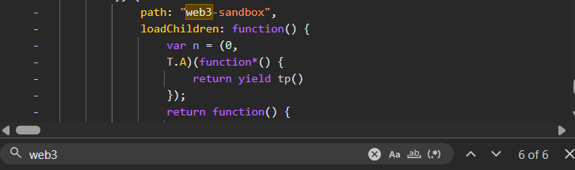
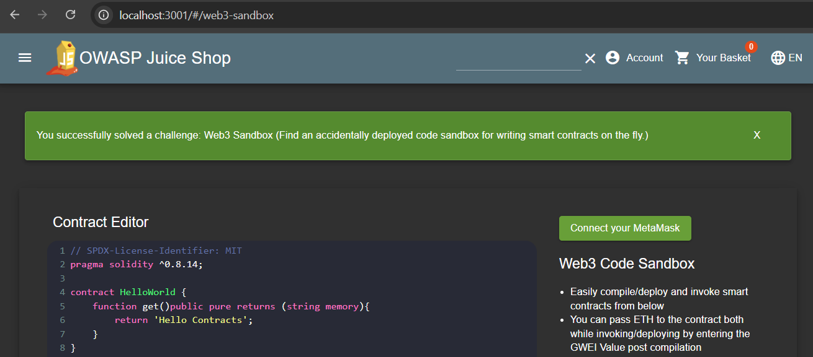

# Web3 Sandbox

- **Difficulty:** ⭐
- **Category:** Broken Access Control
- **Date solved:** 2026-11-25

## The goal

Find an accidentally deployed code sandbox for writing smart contracts on the
fly.

## Background

Like the [Score Board](01-score-board.md), this uses the fact that Juice Shop is
an Angular single-page app: every route the app knows about is inside the
JavaScript sent to the browser, even pages that aren't linked anywhere.

A **smart contract** is a program that runs on a blockchain (like Ethereum),
usually written in a language called **Solidity**. A "sandbox" for them is a
developer tool to write, compile and deploy contracts, the kind of thing that
should never end up on a live shop.

## What I did

### Step 1: Search the source code

I opened DevTools with `F12`, opened the search (`Alt + F`) and searched the
app's JavaScript for **`web3`**.

### Step 2: Find the route

The search had 6 results. The last one (6 of 6) was a route definition:

```js
path: "web3-sandbox",
loadChildren: function() { ... }
```

- `path` is the URL of the page: **`web3-sandbox`**.
- `loadChildren` means the page is **lazy-loaded**: its code is only
  downloaded when someone visits the route.



### Step 3: Visit the page

I went to:

```
http://localhost:3001/#/web3-sandbox
```

The page opened with a **Contract Editor** containing a Solidity
`HelloWorld` contract, a **Connect your MetaMask** button and a description of
the Web3 Code Sandbox. Juice Shop showed the banner "You successfully solved a
challenge: Web3 Sandbox".



## Why it works

The sandbox is a developer tool that was left in the production app. Its route
is still listed in the JavaScript, and the page itself has no access check, so
anyone who finds the URL can open and use it. Not linking to it in the menus
doesn't hide it from someone who reads the source.

## What I learned

- Searching the frontend JavaScript for keywords (`web3`, `admin`, `debug`,
  `test`...) is a quick way to find hidden pages.
- `loadChildren` marks a lazy-loaded route. The page's code isn't downloaded
  until you visit it, but the route itself is still visible.
- Developer and test tools left in production are a real risk.

## Remediation

**Vulnerability:** developer tool deployed to production with no access
control. Related to OWASP Top 10 **A01: Broken Access Control** and
**A05: Security Misconfiguration**.

How a developer should fix it:

1. **Remove developer tools from production builds.** Keep sandboxes, debug
   pages and test features in development-only builds or behind build flags,
   so their routes never ship to users.
2. **Protect any internal tool that must stay** with server-side
   authentication and authorization, for example admins only.
3. **Don't rely on hidden URLs.** Every route in the frontend bundle can be
   found by searching the JavaScript.
4. **Review what gets deployed.** Check the production bundle and routes before
   each release for anything that shouldn't be public.
