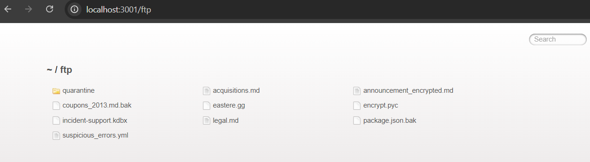
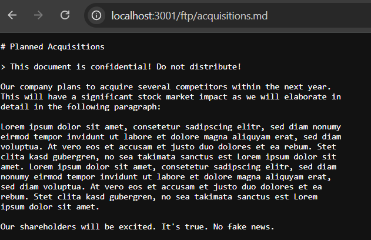

# Confidential Document

- **Difficulty:** ⭐
- **Category:** Sensitive Data Exposure
- **Date solved:** 2026-11-25

## The goal

Access a confidential document.

## Background

Web servers sometimes have **directory listing** turned on. If you visit a
folder's URL instead of a file's, the server shows every file inside it, like a
file explorer. If that folder holds internal files, anyone can browse and
download them.

## How to find `/ftp`: the thought process

The `/ftp` folder isn't linked from the shop's menus, but the app leaves two
clues that point to it:

1. **The "About Us" page links to a file inside `/ftp`.** The link to the
   terms of use goes to `http://localhost:3001/ftp/legal.md`. When you see a
   file served from a folder, the natural next question is: *what else is in
   that folder?* Remove the file name from the URL and visit just `/ftp`.
2. **`robots.txt` mentions it.** `robots.txt` is a public file that tells
   search engines which paths not to index. Juice Shop's
   (`http://localhost:3001/robots.txt`) contains `Disallow: /ftp`. A path that
   a site asks search engines to ignore is often exactly the kind of place
   worth looking at.

The general habit: **whenever a URL points to a file, try the folder it's in**,
and always check `robots.txt` early.

## What I did

### Step 1: Open the `/ftp` folder

I went to:

```
http://localhost:3001/ftp
```

The server showed a directory listing with files like `acquisitions.md`,
`coupons_2013.md.bak`, `incident-support.kdbx`, `package.json.bak` and a
`quarantine` folder.



### Step 2: Open `acquisitions.md`

I opened `acquisitions.md`:

```
http://localhost:3001/ftp/acquisitions.md
```

It's titled **"Planned Acquisitions"** and starts with *"This document is
confidential! Do not distribute!"*. It describes the company's plans to acquire
competitors, which is information that could affect the stock market. Opening
it solved the challenge.



## Why it works

The server has directory listing enabled on `/ftp` and serves its files to
anyone, with no login or permission check. A confidential business document was
stored in that public folder, so anyone who finds the folder can read it.

## What I learned

- When a link points to a file, check the folder it lives in.
- `robots.txt` can reveal paths the site owners don't want people to see.
- Directory listing can expose a whole folder of internal files at once.
- The other files in `/ftp` (backups, a password database, encrypted files)
  look like they belong to other challenges.

## Remediation

**Vulnerability:** confidential file stored in a public folder with directory
listing enabled. Related to OWASP Top 10 **A01: Broken Access Control** and
**A05: Security Misconfiguration**.

How a developer should fix it:

1. **Never store confidential documents in a publicly served folder.** Keep
   internal files on internal systems, not on the web server.
2. **Turn off directory listing** on the web server, so visiting a folder URL
   doesn't show its contents.
3. **Require authentication and authorization** for any files that must be
   served, and check permissions on every request.
4. **Don't use `robots.txt` to hide things.** It's public and is a map for
   attackers. Protect sensitive paths properly instead.
