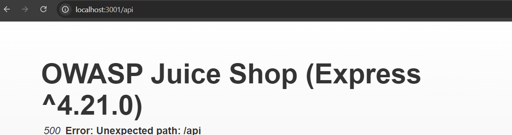
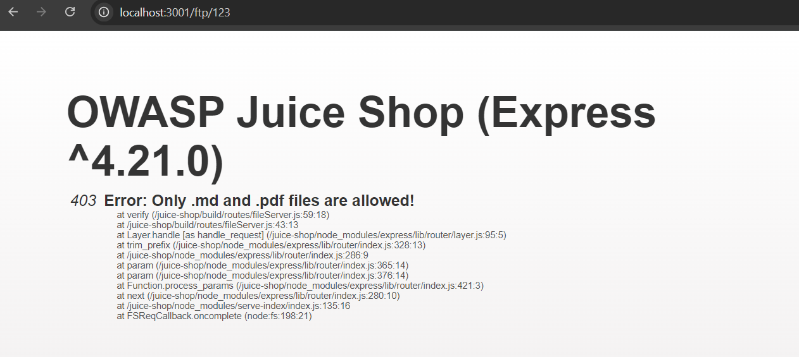

# Error Handling

- **Difficulty:** ⭐
- **Category:** Security Misconfiguration
- **Date solved:** 2026-11-25

## The goal

Provoke an error that is neither very gracefully nor consistently handled.

## Background

Every app runs into errors. The question is how it **handles** them:

- **Handled gracefully:** the user sees a clean, planned message ("Page not
  found", "You don't have access") and nothing about the internals.
- **Not handled:** the server crashes into a raw error page, often a
  **500 Internal Server Error**, that can leak internal details like the
  framework, its version, file paths or a stack trace.

Those leaked details are useful to an attacker, because they show what
technology the server runs and which known vulnerabilities to look for.

## What I did

### Step 1: The administration page (dead end)

My first idea was to open the administration page without being an admin. I
got a **403 Forbidden** page, but that didn't solve the challenge.

That makes sense: a 403 is the app working correctly. It checks that I'm not
allowed in and shows a clean, deliberate error page. That's *good* error
handling, and the challenge asks for the opposite.

### Step 2: Think about the backend

From the [Confidential Document](07-confidential-document.md) challenge, I
knew the app has two sides:

- the **frontend** (Angular), which draws pages in the browser and has its own
  error pages
- the **backend** (the server), which answers requests directly and serves
  paths like `/ftp`

Unexpected errors are more likely on the backend, where requests go straight to
the server without the frontend's nice error pages in front. Juice Shop's
backend API lives under paths like `/api` and `/rest`, so I tried sending a
request it wouldn't expect.

### Step 3: Request `/api` on its own

I went to:

```
http://localhost:3001/api
```

`/api` is the start of the API's paths, but on its own it's not a valid
endpoint. Instead of a clean "not found" message, the server returned a raw
error page:

```
OWASP Juice Shop (Express ^4.21.0)
500 Error: Unexpected path: /api
```

The challenge was solved.



### Step 4: Another unhandled error in `/ftp`

I also tried a file that doesn't exist in the `/ftp` folder:

```
http://localhost:3001/ftp/123
```

This gave another raw error page, and this one leaks even more:

```
403 Error: Only .md and .pdf files are allowed!
    at verify (/juice-shop/build/routes/fileServer.js:59:18)
    at /juice-shop/build/routes/fileServer.js:43:13
    at Layer.handle [as handle_request] (/juice-shop/node_modules/express/lib/router/layer.js:95:5)
    ...
    at /juice-shop/node_modules/serve-index/index.js:135:16
    at FSReqCallback.oncomplete (node:fs:198:21)
```

The list of `at ...` lines is a **stack trace**: the chain of functions the
server was running when the error happened. It reveals:

- the server's **internal folder structure** (`/juice-shop/build/routes/`)
- the **source file and line** that checks file types
  (`fileServer.js`, line 59, function `verify`)
- the **libraries** in use (`express`, `serve-index`) and that it runs on
  **Node.js** (`node:fs`)
- the **rule** the server enforces: only `.md` and `.pdf` files are allowed,
  which is a hint for later challenges about getting around that filter

It's also a good example of *inconsistent* handling: the administration page's
403 was a clean, designed page, but this 403 is a raw page with a full stack
trace.



## Why it works

The backend has no planned response for a request to `/api` by itself, so the
error falls through to the server's default error handler. That handler:

- returns **500 (server error)** for what is really just a wrong URL, where a
  **404 (not found)** would be correct
- shows a raw, unstyled page instead of the app's normal design
- **leaks technical details**: the server runs **Express**, a Node.js web
  framework, version **^4.21.0**

An attacker can use that version to look up known vulnerabilities for that
exact framework.

## What I learned

- A 403 page is often *good* error handling, not a bug.
- Backend paths (`/api`, `/rest`) are a better place to provoke unexpected
  errors than frontend pages.
- Error pages can leak the technology stack and versions, which helps attackers
  plan their next step.
- The right status code matters: a wrong path should be a 404, not a 500.
- Stack traces leak file paths, source file names, line numbers and libraries,
  and error messages can reveal the server's rules (like the `.md`/`.pdf`
  filter).

## Remediation

**Vulnerability:** unhandled server error that leaks framework and version
information. Related to OWASP Top 10 **A05: Security Misconfiguration**.

How a developer should fix it:

1. **Add a custom error handler** that catches all errors and returns a
   generic, consistent message (for example "Something went wrong") with no
   technical details.
2. **Return correct status codes:** 404 for unknown paths, 400 for bad input,
   and 500 only for real server failures.
3. **Run in production mode.** Frameworks like Express show detailed error
   pages and stack traces in development mode. Production mode should never
   expose them.
4. **Log details on the server, not in the response.** Developers can still
   debug from server logs while users see nothing internal.
5. **Hide version information**, such as the framework name and version in
   error pages and in headers like `X-Powered-By`.
