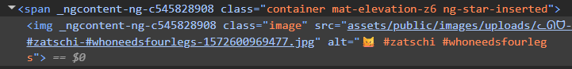
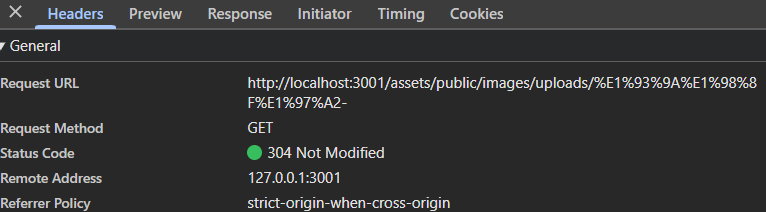
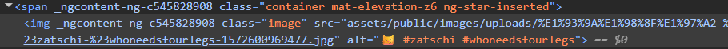

# Missing Encoding

- **Difficulty:** ⭐
- **Category:** Improper Input Validation
- **Date solved:** 2026-11-25

## The goal

Retrieve the photo of Bjoern's cat in "melee combat-mode".

## Background

Some characters have a **special meaning in URLs**. The most important one
here is `#`: everything after a `#` is the **fragment**, which the browser
keeps for itself and **never sends to the server**. (That's how Juice Shop's
`/#/score-board` style routes work, as seen in earlier challenges.)

So if a file name contains a `#` and it's put in a URL without encoding, the
browser cuts the request off at the `#` and asks the server for the wrong
file. To use a `#` as a normal character in a URL, it must be
**URL-encoded** as `%23`.

## What I did

### Step 1: Inspect the cat photo

I inspected the cat photo's `` element with DevTools (**Elements** tab).
Its caption (`alt`) is "😼 #zatschi #whoneedsfourlegs", and its `src` is:

```
assets/public/images/uploads/ᓚᘏᗢ-#zatschi-#whoneedsfourlegs-1572600969477.jpg
```

The file name contains two `#` characters, plus special Unicode characters at
the start (`ᓚᘏᗢ`, which look like a cat).



### Step 2: Check what the browser actually requested

To see what really happened, I looked at the image's request in DevTools'
**Network** tab. The request URL was:

```
http://localhost:3001/assets/public/images/uploads/%E1%93%9A%E1%98%8F%E1%97%A2-
```

Decoding the end of it gives just:

```
ᓚᘏᗢ-
```

So the browser only sent the part **before the first `#`**. Everything after
it (`#zatschi-#whoneedsfourlegs-1572600969477.jpg`) was treated as a fragment
and never reached the server. The browser asked for a file called `ᓚᘏᗢ-`,
which isn't the photo, so the photo couldn't load.



### Step 3: Encode the file name

I encoded the file name with [urlencoder.org](https://www.urlencoder.org/):

```
%E1%93%9A%E1%98%8F%E1%97%A2-%23zatschi-%23whoneedsfourlegs-1572600969477.jpg
```

- each `#` became `%23`, so it's now part of the file name instead of starting
  a fragment
- the cat characters `ᓚᘏᗢ` became `%E1%93%9A%E1%98%8F%E1%97%A2` (their UTF-8
  bytes)

### Step 4: Replace the `src`

In the Elements tab I replaced the file name in the image's `src` with the
encoded version. This time the browser requested the full, correct file name,
the cat photo loaded, and the challenge was solved.



## Why it works

The app builds the image URL directly from the uploaded file name without
encoding it. The `#` characters in the name break the URL, so the browser
requests the wrong path. Encoding the name restores the real path, and the
server returns the photo.

## What I learned

- `#` in a URL starts the fragment, and the browser never sends the fragment
  to the server.
- Special characters in URLs (`#`, `?`, `&`, spaces, Unicode) must be
  URL-encoded to be used as normal text.
- DevTools' Elements tab lets you edit a page's HTML live, which is handy for
  testing fixes and payloads.
- The Network tab shows the exact URL the browser sent, which is the best way
  to confirm what the server actually received.

## Remediation

**Vulnerability:** user-supplied file name used in a URL without encoding.
Related to OWASP Top 10 **A03: Injection** (improper input handling).

How a developer should fix it:

1. **Always URL-encode dynamic values** when building URLs, for example with
   JavaScript's `encodeURIComponent()`, so characters like `#`, `?` and `&`
   can't change the URL's meaning.
2. **Sanitize uploaded file names.** Strip or replace special characters, or
   better, **rename uploads** to a safe generated name (like a random ID) and
   keep the original name separately as data.
3. **Validate input on upload**, allowing only expected characters in names
   and captions.
