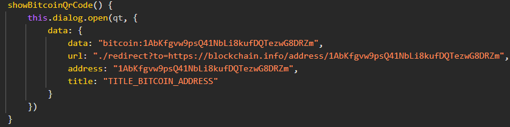

# Outdated Allowlist

- **Difficulty:** ⭐
- **Category:** Unvalidated Redirects
- **Date solved:** 2026-11-25

## The goal

Let the shop redirect you to one of its cryptocurrency addresses that isn't
promoted any longer.

## Background

Juice Shop has a **redirect** endpoint: `/redirect?to=<URL>`. The app uses it
for external links. Instead of linking straight to another site, it sends you
through `/redirect`, which forwards you to the `to` address.

To stop attackers from abusing this to send people to any site they want (an
**open redirect**), the server only allows addresses that are on an
**allowlist**. The weakness in this challenge: the allowlist was never cleaned
up. Addresses the shop no longer uses are still on it.

## What I did

### Step 1: Search the source code for crypto addresses

I opened DevTools and searched the app's JavaScript (`main.js`) for the
cryptocurrency code. I found a function called `showBitcoinQrCode()`:

```js
showBitcoinQrCode() {
    this.dialog.open(qt, {
        data: {
            data: "bitcoin:1AbKfgvw9psQ41NbLi8kufDQTezwG8DRZm",
            url: "./redirect?to=https://blockchain.info/address/1AbKfgvw9psQ41NbLi8kufDQTezwG8DRZm",
            address: "1AbKfgvw9psQ41NbLi8kufDQTezwG8DRZm",
            title: "TITLE_BITCOIN_ADDRESS"
        }
    })
}
```

This is code for showing a **Bitcoin** QR code. The shop doesn't show a
Bitcoin option anywhere in the interface anymore, but the code is still there,
including the redirect link it used:

```
./redirect?to=https://blockchain.info/address/1AbKfgvw9psQ41NbLi8kufDQTezwG8DRZm
```



### Step 2: Use the old redirect

The code gave me the Bitcoin address `1AbKfgvw9psQ41NbLi8kufDQTezwG8DRZm`.
`blockchain.info` is the old name of **blockchain.com**, so I used the same
Bitcoin address on blockchain.com's explorer as the redirect target:

```
http://localhost:3001/redirect?to=https://www.blockchain.com/explorer/addresses/btc/1AbKfgvw9psQ41NbLi8kufDQTezwG8DRZm
```

The server accepted it and redirected me to the Bitcoin address page, which
solved the challenge.

## Why it works

The Bitcoin address was removed from the shop's interface, but its URL was
never removed from the server's redirect allowlist. Because the server still
trusts it, the redirect goes through. The allowlist is **outdated**: it allows
more than the shop actually uses today.

## What I learned

- Old code left in the frontend bundle can reveal features that were removed
  from the interface.
- Redirect endpoints (`/redirect?to=...`) are worth testing, since they decide
  where users are sent.
- An allowlist is only as good as its maintenance. Old entries stay
  dangerous until they're removed.

## Remediation

**Vulnerability:** redirect allowlist containing outdated entries. Related to
OWASP **Unvalidated Redirects and Forwards** and Top 10 **A01: Broken Access
Control**.

How a developer should fix it:

1. **Keep the allowlist up to date.** When a feature, partner or payment
   method is removed, remove its URLs from the allowlist at the same time.
2. **Remove dead code** from the frontend, so retired features and their links
   don't keep shipping to every user.
3. **Match allowlisted URLs exactly.** Compare the full destination URL to
   each entry, rather than checking whether it merely *contains* an allowed
   string, which attackers can trick.
4. **Avoid user-controlled redirects where possible.** Use IDs that the server
   maps to fixed URLs (for example `/redirect?id=bitcoin`) instead of accepting
   a full URL in the request.
5. **Warn users before leaving the site**, for example with an "You are now
   leaving Juice Shop" page.
