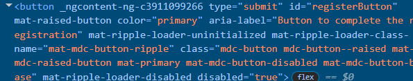

# Repetitive Registration

- **Difficulty:** ⭐
- **Category:** Improper Input Validation
- **Date solved:** 2026-11-26

## The goal

Follow the DRY principle while registering a user.

## Background

**DRY** stands for **"Don't Repeat Yourself"**, a programming principle. Here
it's a hint about the registration form, which asks you to type your password
twice ("Password" and "Repeat Password"). The challenge is to register
*without* repeating it correctly, meaning with two passwords that don't match.

Websites usually check form input in two places:

- **Client-side**, in the browser: fast feedback for the user, but the user
  controls the browser, so these checks can be changed or skipped.
- **Server-side**, on the backend: the real protection, because the user can't
  change it.

If a rule is only checked in the browser, it can be bypassed.

## What I did

### Step 1: Fill in the form with mismatched passwords

On the registration page I filled in the email, the security question and
answer, and the password fields, but typed **different** values in "Password"
and "Repeat Password". The form showed an error and the **Register** button
stayed greyed out.

### Step 2: Understanding the frontend validation

The **frontend** is the part of the application running in my browser. It
contains logic that checks whether both passwords match. Conceptually, it
works like this:

```js
if (password !== passwordRepeat) {
    disableRegisterButton();
}
```

This is why the Register button had:

```html
disabled="true"
```

I confirmed it by right-clicking the button and opening it in DevTools'
**Elements** tab:



`disabled` is a standard HTML attribute. While it's on the button:

- the button is **greyed out**
- it **can't be clicked** or reached with the keyboard
- it **can't submit** the form

It's also a **boolean attribute**: only its presence matters, not its value.
Even `disabled="false"` still disables the button. The only way to enable it
is to remove the attribute completely.

Here's the important distinction:

> **Disabling a button is not security enforcement.**
> It is simply a user-interface restriction.

### Step 3: What I actually did

I opened DevTools → **Elements** and modified the HTML.

Originally:

```html
<button id="registerButton" disabled="true">
    Register
</button>
```

I changed it to:

```html
<button id="registerButton">
    Register
</button>
```

What happened?

- The browser no longer considered the button disabled.
- I could click **Register**.
- The browser sent the registration request to the backend.
- The backend **accepted the registration** even though the passwords didn't
  match.

That last point is the actual vulnerability. The challenge was solved.

(Tip: if you type in the form again after removing `disabled`, Angular may add
it back, so remove it right before clicking.)

## Why it works

The "passwords must match" rule only exists in the **frontend**, as a disabled
button. The **backend** never checks that the two passwords match. Removing
the browser-side restriction was enough, because nothing on the server was
there to stop the request.

The browser is fully under the user's control. Any check that only happens
there can be edited, skipped, or bypassed by sending the request directly.

## What I learned

- Anything in the browser (HTML attributes, disabled buttons, form checks)
  can be edited with DevTools.
- Client-side validation is for user convenience, not security.
- Every rule that matters must also be checked on the server.

## Remediation

**Vulnerability:** validation only done on the client side. Related to OWASP
Top 10 **A04: Insecure Design** (improper input validation).

How a developer should fix it:

1. **Validate on the server.** Check that the password and its confirmation
   match on the backend, and reject the request if they don't. The same goes
   for every other rule: required fields, length, format.
2. **Keep client-side checks only for user experience.** They're useful for
   instant feedback, but never rely on them for security.
3. **Test forms by bypassing the frontend**, for example by editing the HTML
   or sending requests directly, to make sure the server enforces every rule
   on its own.
